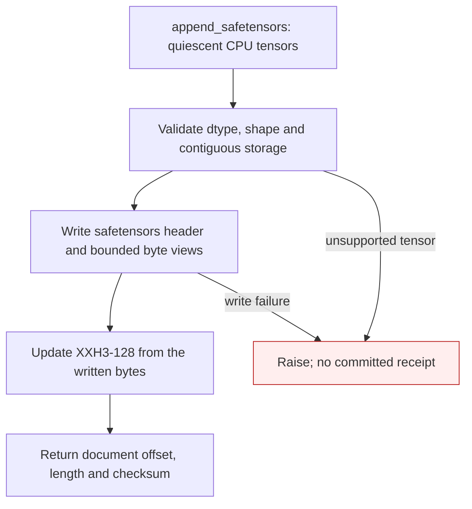
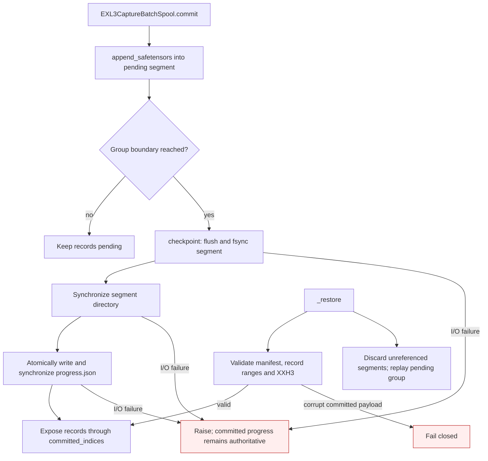

# Streamed checkpoint payloads

GPT-QModel writes internal tensor payloads through
`gptqmodel.utils.checkpoint_io`. The writer borrows quiescent, contiguous CPU
tensor storage in bounded byte views, emits ordinary safetensors documents,
and computes XXH3-128 while writing. It does not allocate a serialized copy of
the complete payload or reopen the output to calculate its checksum. The
caller must keep the tensors and their storage unchanged until the write
returns.

XXH3-128 detects accidental corruption; it does not authenticate untrusted
artifacts. Source identities, small canonical request identities and hashes
required by external protocols keep their declared algorithms. Legacy
checkpoint receipts retain their original algorithm when read.

New generic object references have the form `xxh3-128-<32 lowercase hex
digits>`; unprefixed 64-digit references still mean SHA-256. Projection schema
2 records `tensor_hash_algorithm: xxh3-128` and `tensor_xxh3_128`, and its large
input-weight/Hessian tensor identities also use XXH3-128. Schema 1 projection
payloads retain SHA-256 validation. The remote envelope's existing checksum
format remains explicit rather than inheriting the new tensor-identity default.

| Previous mechanism (base `5d93c9de`) | Replacement |
| --- | --- |
| `gptqmodel/looper/input_cache.py:492`: save a shard, synchronize it, then reopen it for XXH3 | Stream the checksum during shard serialization |
| `gptqmodel/utils/exl3_capture_batch_spool.py:309`: separate batch payload files; checkpoint synchronizes each pending file | Append records to a bounded segment and synchronize that segment once per group |
| `gptqmodel/utils/exl3_projection_checkpoint.py:555`: serialize a complete projection to bytes before publishing | Stream the safetensors payload with an explicitly tagged checksum |
| `gptqmodel/looper/checkpoint_store.py:157`: SHA-256-only content-addressed objects | Algorithm-tagged internal references, with legacy SHA-256 reads |

## Capture group durability

`EXL3CaptureBatchSpool` distinguishes pending records from committed records.
Its default checkpoint interval is 32 batches; the segment byte bound can seal
a group earlier. A final short group also commits. Changing this cadence does
not change the capture key or the tensor calculations.

The manifest is the recovery authority. A segment surviving without a manifest
reference does not prove completion. An interrupted group is replayed; a
committed group is validated and reused. Individual projection checkpoints and
generic immutable objects still synchronize their standalone payloads before
their commit metadata becomes durable. Removing all synchronization would
invalidate those recovery guarantees.

Directory synchronization is a POSIX contract. On other platforms the shared
writer preserves the activation cache's previous file-sync and atomic-replace
behavior without opening unsupported directory handles or requiring `fchmod`.
POSIX directory synchronization failures still propagate; they are never
silently ignored.

These changes affect storage and checkpoint cadence. They do not change
quantization arithmetic, tensor values or an already running process. Tests
use small CPU fixtures and injected failures; they do not establish a
whole-model speedup or explain every source of host latency.
