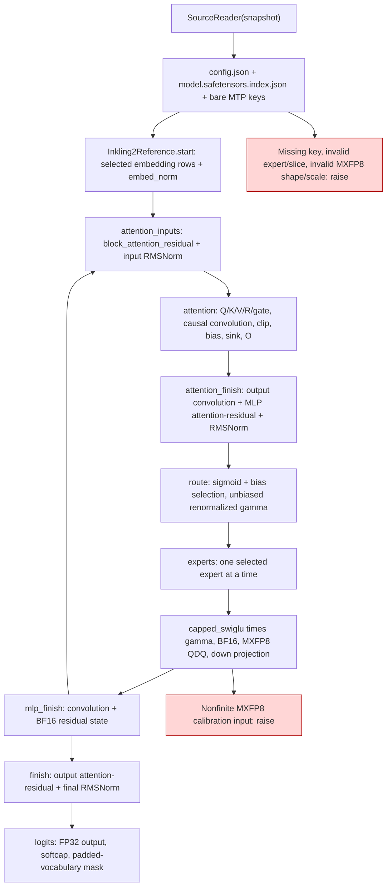
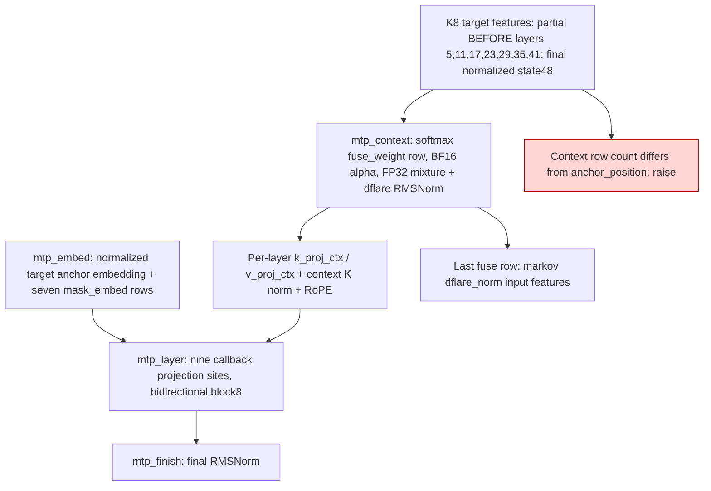

# Inkling 2 streamed calibration reference

`gptqmodel/utils/inkling2_core.py` supplies an explicit reference adapter for
Inkling 2 MXFP8 calibration. It does not add a registered model, change normal
GPT-QModel loading or quantization dispatch, or select a quantization method.
The orchestrator owns device leases, reconstruction/encoding, Hessians,
checkpoint receipts and publication.

The numerical authority is the vendor-linked SGLang
[`inkling-2-small-support` branch at ec5e7ff575beb33e54509fe01934d6a4483b5830](https://github.com/sgl-project/sglang/tree/ec5e7ff575beb33e54509fe01934d6a4483b5830).
The main SGLang branch's older `inkling.py` is not the Inkling 2 implementation.
The reference adapter translates its math into bounded Torch operations rather
than starting a distributed serving framework. Dense attention deliberately
limits its use to bounded calibration prompt lengths.

| Existing mechanism | Added explicit adapter |
| --- | --- |
| Existing Inkling model loading/replay remains in `gptqmodel/models/definitions/inkling.py:156` | `Inkling2Reference` provides phased target and MTP replay, without changing that definition |
| No native Inkling 2 orchestration in the existing definition | `SourceReader` reads standard checkpoint index/config and exposes separately indexed MTP names with `mtp.` |
| No caller-owned causal reconstruction callback in this new source path | `project(name,x,weight)` calls the supplied override before falling back to the current source projection |

`attention_inputs(state,L)` returns full checkpoint tensor names mapped to the
actual BF16 projection inputs. `attention(state,L,linear_override)` returns the
raw O output and the exact O input produced by that replay. `attention_finish`
returns `(PendingLayer, mlp_input)`; `mlp_finish` consumes that pending attention
and the caller's combined expert output. This permits Q/K/V/R/gate K8
reconstructions to feed the O Hessian and completed K8 attention to feed expert
Hessians without recomputing source experts. A callback can stop by raising its
own exception; no exception is suppressed.

The callback receives `(checkpoint_name, activation, current_weight)` and returns
a replacement output or `None`. Expert names are physical fused keys with an
index suffix, for example `model.llm.layers.0.mlp.experts.w13_weight[17]`.
`SourceReader.expert(..., projection="gate"/"up"/"down")` exposes logical
projection views. Both activations and weights supplied to a callback belong
to the current operation; the adapter does not retain them after use.

Critical source-format contracts:

- MXFP8 U8 scales have shape `[expert, output_row, input_width/32]`, even when
  quantization metadata says `weight_block_shape=[32,32]`. UE8M0 byte zero is
  `2^-127`; byte 255 is rejected. Activation block scales round upward to the
  next power of two and E4M3 payloads round to nearest-even.
- Native w13 output rows interleave gate and up. Its activation is
  `4*tanh(gate/4)*sigmoid(raw_gate)*25*tanh(up/25)*gamma`; the route weight is
  applied before the BF16 activation round and down-input MXFP8 quantization.
- Residual sums and attention-residual mixtures accumulate in FP32. Stored
  target partials and finished blocks remain BF16. Input and final RMSNorm
  output is BF16; the head matmul output and softcap computation are FP32.
- Target attention uses relative bias, not RoPE. Dynamic global K/V convolution
  taps run current-to-oldest, while static taps run oldest-to-current. Residual
  convolution normalization is `sqrt(K+1)` or `sqrt(2K+1)` respectively.

MTP context rows strictly precede the block anchor; local context windows are
anchored at the block start. The drafter uses ordinary per-head Q/K RMSNorm,
NeoX RoPE, plain SiLU gating, and normal pre-norm residuals. Its target features
are captured from the K8 target path. This adapter supplies dense-projection
calibration/replay only; the unmodified Markov head is outside quantization.
Drafter K8/K6 quality is evaluated by the complete engine, not a drafter pilot.

Validation: `tests/utils/test_inkling2_core.py` contains independent scalar or
float64 Torch oracles for complete MXFP8 bytes at midpoint/scale boundaries,
selected-expert reads, native interleaving/gamma order, attention-residual,
convolutions, and sink/GQA/window attention. Synthetic replay tests cover local
and global projection hooks, BF16 state, and all nine MTP calibration sites.
These are CPU tests. They do not claim bitwise equality with SGLang's fused
GPU reduction order or qualify an optimized GPU kernel. Actual-device smoke
and quantization quality remain the orchestrator's gates.
